# degoog Toolkit

[degoog](https://github.com/degoog-org/degoog) store repository for SearXNG engines, plugins, and themes.

> **Compatibility:** full-width plugins and themes require degoog 0.24 or newer. Check the item's minimum version in the Store before installing it.

This repository is forked from and based on the work by [SiaoZeng](https://github.com/SiaoZeng) (from [degoog-searxng-extensions](https://github.com/SiaoZeng/degoog-searxng-extensions)).

We are incredibly grateful to the original authors and contributors in the `degoog` community whose tools, plugins, themes, and examples laid the foundation for this repository, including:

- **[Arkmind](https://github.com/Arkmind)** (creator of the Trankil plugin suite under the author name *arky*, including `calculator`, `stopwatch`, `tmdb`, etc.)
- **[Georgvwt](https://github.com/Georgvwt)** (creator of various slots and plugins like `osm-slot`, `define-slot`, etc.)
- **[TheAnnoying](https://github.com/TheAnnoying)** (creator of the original `LiterallyGoogle` theme)
- **[Federico Dossena](https://github.com/adolfintel)** (creator of the underlying Speedtest)
- **Ben Ng** (creator of the unit/convert-units code)
- **[fccview](https://github.com/fccview)** (creator of degoog and various extensions)

## AI Usage Awareness

Before I started this repository, I forked it from https://github.com/SiaoZeng/degoog-searxng-extensions, which was coded alongside Claude, and as such, Claude is a contributor on this repo. I myself don't "vibe code", but AI was used in the making of these extensions, with a combination of Github Copilot used for autocompletions, and a local llm running on my own machine for longer completions.

## Included Themes

Click a theme to expand screenshots.

Both themes show image-engine filters in a swipeable row on mobile. Engine
failure reasons remain visible in those controls, including timeouts and blocks.

Toolkit knowledge panels use the same full-width collapse headers and chevrons
as Engine Performance in both themes. Their controls stay independently usable,
and a manual open or closed choice survives streamed panel replacement.

<details>
<summary><strong>LiterallyGoogle</strong> — Google-like results styling with a sticky header and native full-width above-results plugin slots</summary>

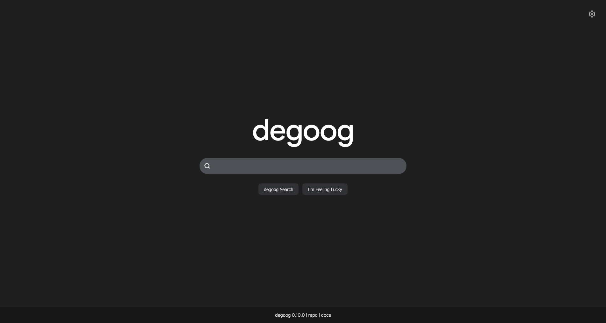

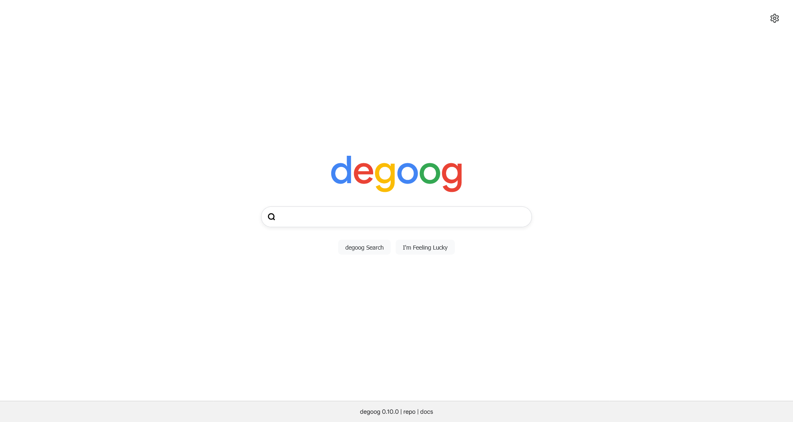

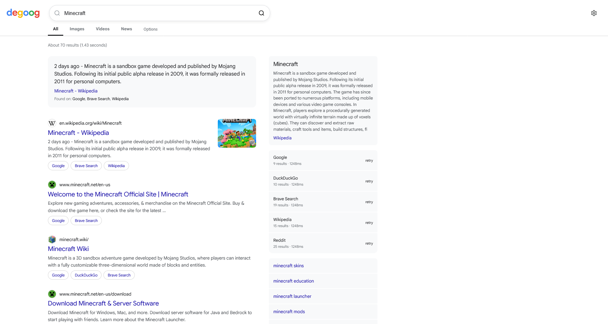

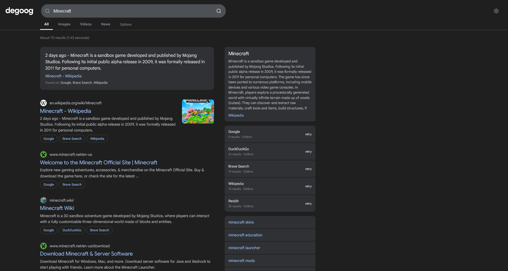

</details>

<details>
<summary><strong>LiterallyApple</strong> — Apple-inspired liquid-glass styling with native full-width plugin slots</summary>

</details>

## Included Plugins

Click a plugin name to expand screenshots and previews.

<details>
<summary><strong>Engine Quality Dashboard</strong> — Admin-only reliability, latency, failures, and result counts with shared server-side history</summary>

Open with `!eq`. The dashboard and JSON export require your existing
degoog admin login. It records live engine calls separately from cache hits,
with hourly activity, failure categories, average/estimated p95 response times,
empty-result counts, search-type filters, and sortable engine rows.

History is stored privately on the server, survives restarts, and defaults to
48-hour retention. Search queries, result URLs, IP addresses, and raw error text
are never stored. See [setup and metric definitions](plugins/engine-quality-dashboard/README.txt).

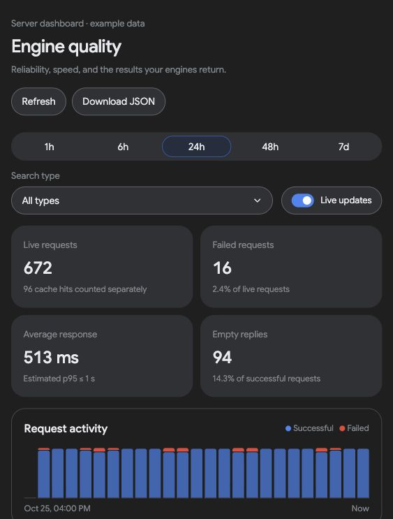

</details>

<details>
<summary><strong>Weather</strong> — Interactive charts, 7-day forecast, sunrise/sunset arc, and configurable units</summary>

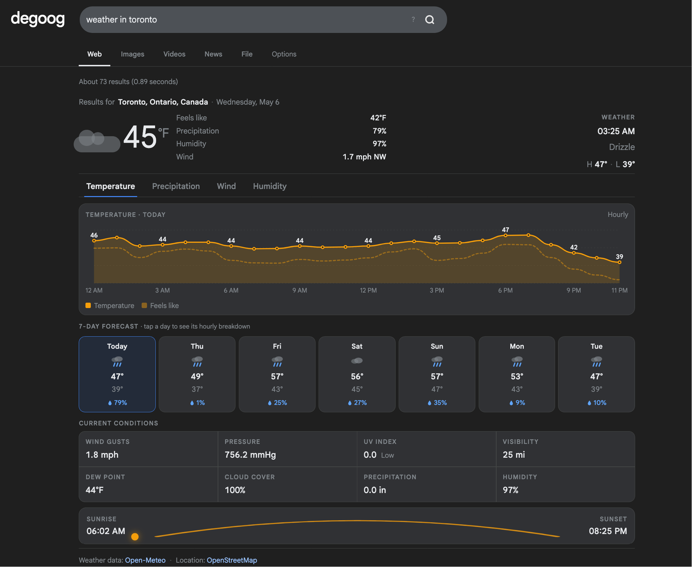

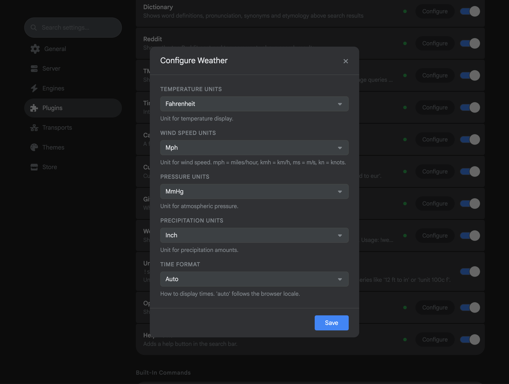

</details>

<details>
<summary><strong>Calculator</strong> — Scientific calculator with keypad and local canvas graphing</summary>

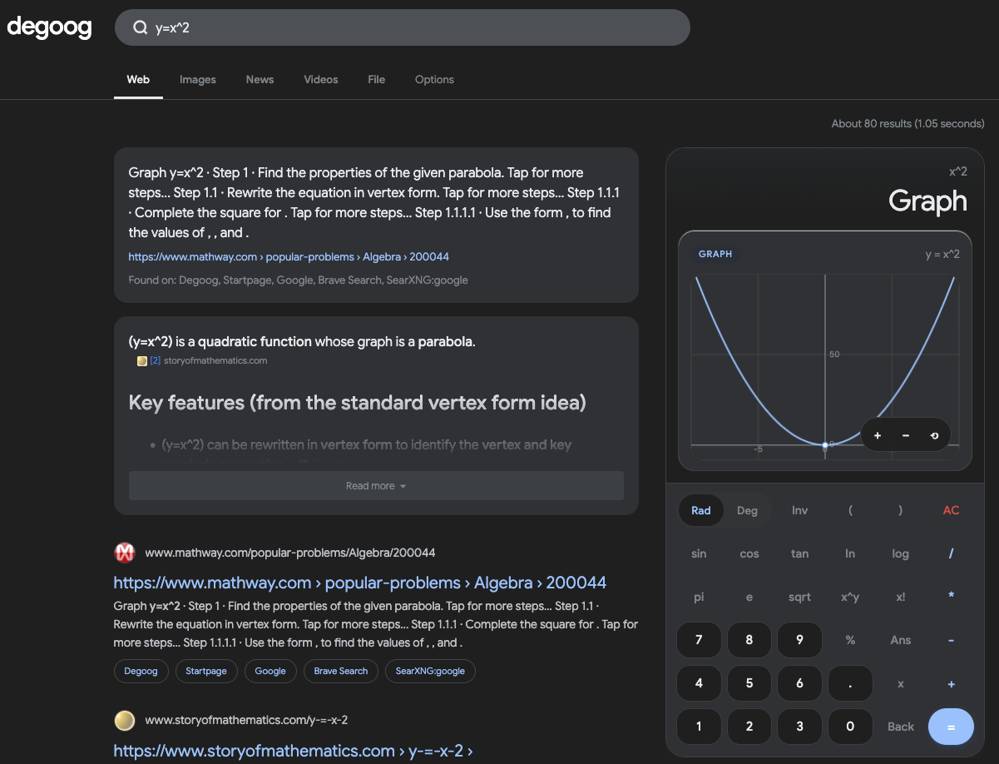


</details>

<details>
<summary><strong>Unit Converter</strong> — Natural unit conversion, decimal/binary storage, data rates, quick comparison tiles, and a remembered compact view</summary>

Try `25.4oz to ml`, `15 gb to mb`, `15 GiB to MiB`, or `100 Mbps to MB/s`.
Lowercase storage shorthand (`gb`, `mb`) means bytes; explicit `Gb`/`Mb` means bits.
Decimal GB/MB use powers of 1000; binary GiB/MiB use powers of 1024.
Click a comparison tile to choose that target unit, or collapse the card to an equation; the browser remembers your compact-view preference.
Click anywhere in the header outside the category picker to collapse or expand the card.
The native category picker groups measurements into everyday, time and motion, computing, electricity and energy, and science and engineering sections.

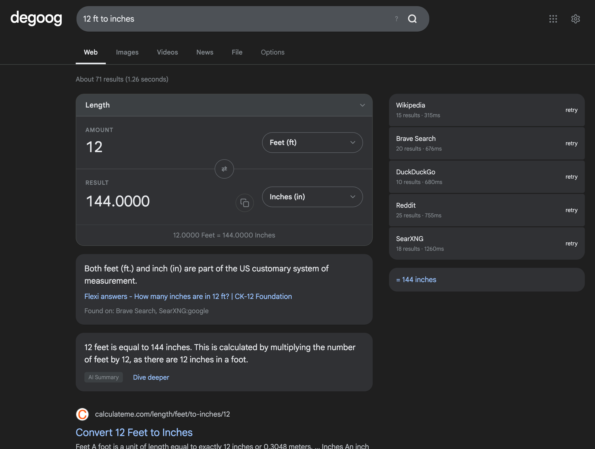

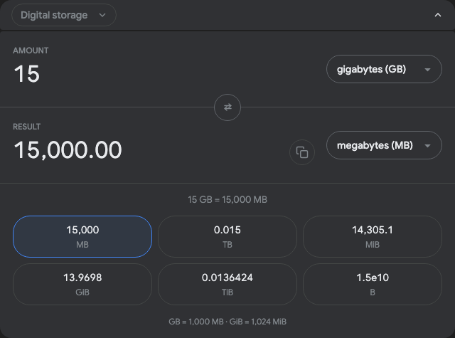

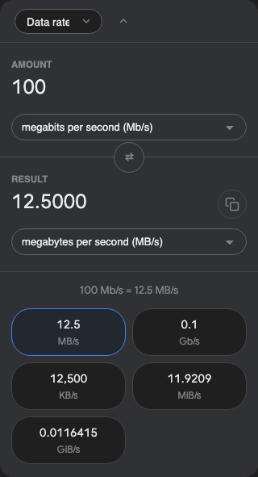

</details>

<details>
<summary><strong>Currency</strong> — Live fiat and crypto conversion (`100 usd to eur`, `!currency`)</summary>

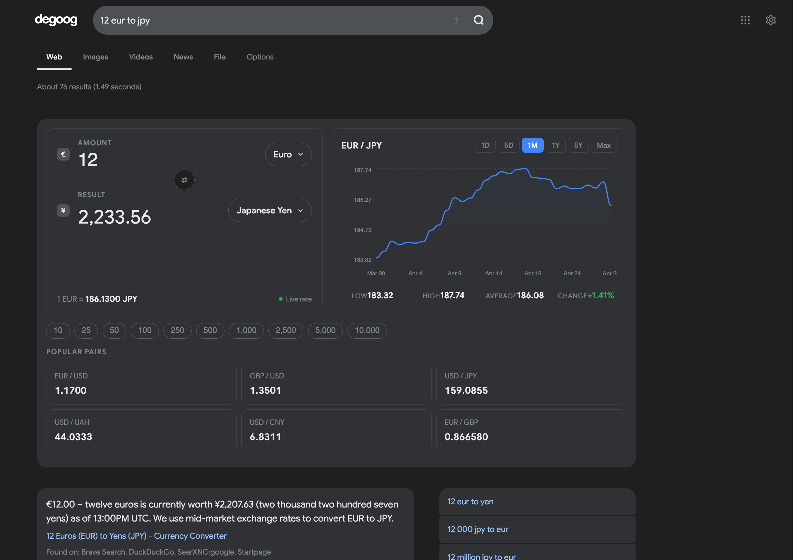

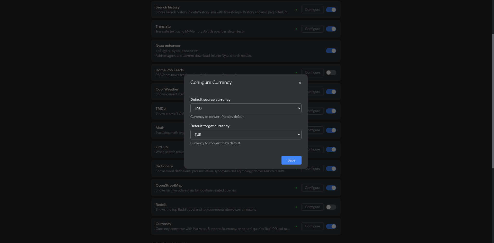

</details>

<details>
<summary><strong>Translate</strong> — Server-side translation with provider switching and speech</summary>


</details>

<details>
<summary><strong>Dictionary</strong> — Definitions, pronunciation, synonyms, and origin</summary>

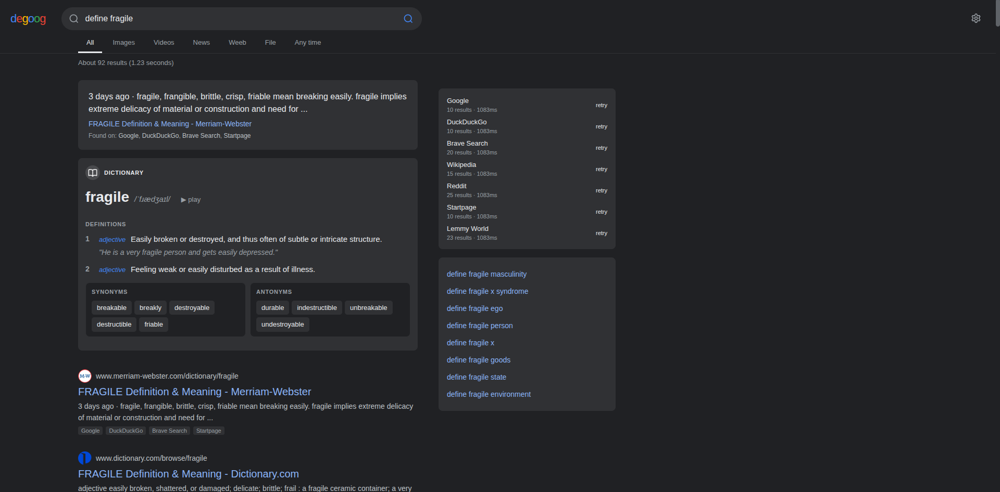

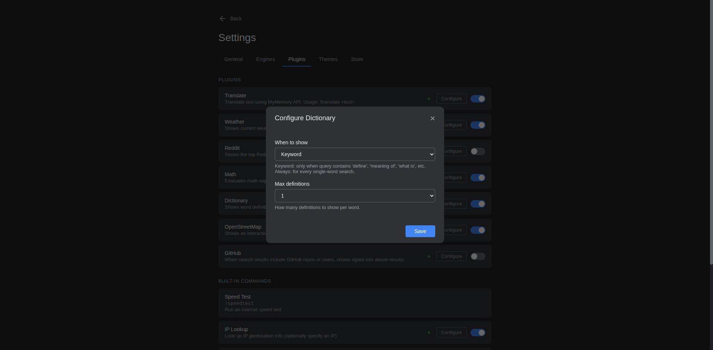

Configure **Definition source** to use Free Dictionary API or Wiktionary for
English meanings. Wiktionary definitions are attributed on the card and avoid
depending on Dictionary API when that service blocks your server. Dedicated
pronunciation and origin requests continue using Free Dictionary API; its
availability is still required for those features. Synonyms and antonyms come
from Power Thesaurus and never substitute silently for a missing definition.

</details>

<details>
<summary><strong>Places</strong> — NLP-assisted local place cards with hours, phone, directions, and map (HERE API key required)</summary>

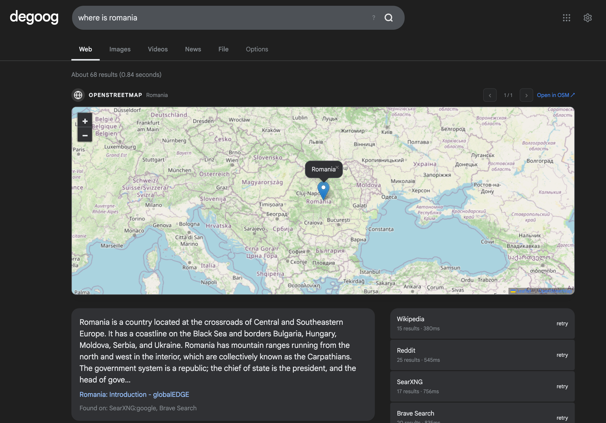


The default map uses OpenStreetMap standard tiles with no account or key.
It follows degoog's light/dark appearance; dark mode recolors only the map imagery.
MapTiler's supported built-in styles switch to their real dark counterpart using
the key already in your custom URL. For other styles, supply **Dark map tile URL**;
unknown custom URLs are never rewritten or recolored. **Map appearance** can also
force light or dark mode. Tile-provider keys belong in their custom URL, not the HERE key field.

OpenStreetMap's shared servers are best-effort, not an unlimited hosting service.
The map requests visible tiles directly and respects browser caching. High-traffic
deployments should configure their own provider. See the
[OSM tile policy](https://operations.osmfoundation.org/policies/tiles/).

**Places** uses a vendored Compromise NLP parser plus conservative safety guards to recognize local intent without turning general searches into place cards. It keeps HERE as the rich POI/details provider and uses OpenStreetMap/Nominatim to validate NLP-derived location phrases and as a geocoding fallback. Supported shapes include bare business names like `Starbucks`, `Walmart`, `Target`, and `Subway`; explicit local queries like `Target near me`; category/location phrasing like `cafes around Chicago`; and landmark directions like `directions to Eiffel Tower`.

Local intent checks run before either API. Title case and an NLP organization tag alone are not enough; unknown ambiguous names need a physical business/category clue or explicit local wording. Technical/informational queries such as `IP address`, `phone reviews`, `coffee benefits`, and `where is config` stay out of Places. `Starbucks hours`, `vegan restaurants near me`, and `Tower of London` still work. These are conservative heuristics, not a guarantee that every name can be classified without looking it up.

</details>

<details>
<summary><strong>Stocks</strong> — Stock quotes with Yahoo Finance data and chart ranges</summary>


</details>

<details>
<summary><strong>TMDB</strong> — Movie, TV, and actor panels (TMDB API key required)</summary>

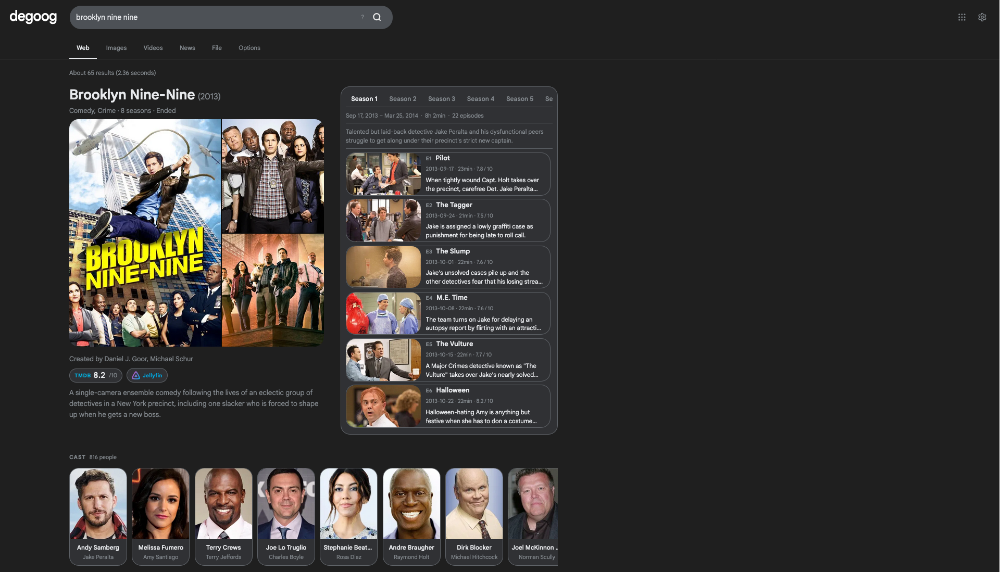

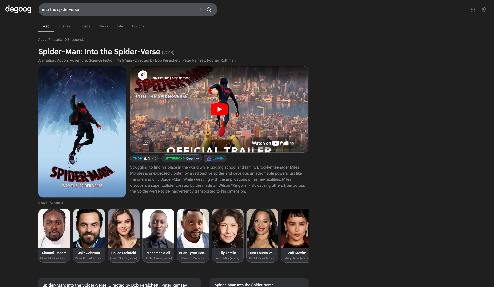


To open trailers in Invidious, set **YouTube / Invidious URL** in TMDB's
plugin settings to your instance's base URL. Leave it blank to use YouTube.
This changes trailer links only; thumbnails still come through degoog's image proxy.

</details>

<details>
<summary><strong>Music / Discography</strong> — Artist, album, and track cards from MusicBrainz</summary>

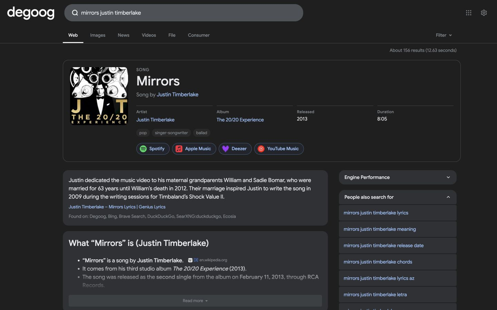

Try `radiohead discography`, `album ok computer`, or `track paranoid android`. Artist links open the full MusicBrainz discography, while Apple Music, Deezer, and Spotify pills open service searches. The card defaults to full width and can be moved to the knowledge panel in Settings → Plugins.

Song titles can also trigger a card when one of the first eight search results
is a matching Spotify, Apple Music, or SoundCloud track page. The result must
identify both the title and artist; playlists, profiles, and unrelated mentions
do not qualify. MusicBrainz must confirm the same song and artist before these
new matches render. Conflicting artists are left alone. No streaming-service
API keys or extra requests to those services are needed.

</details>

<details>
<summary><strong>Books / ISBN</strong> — Rich book details and author collections from Hardcover or Open Library</summary>

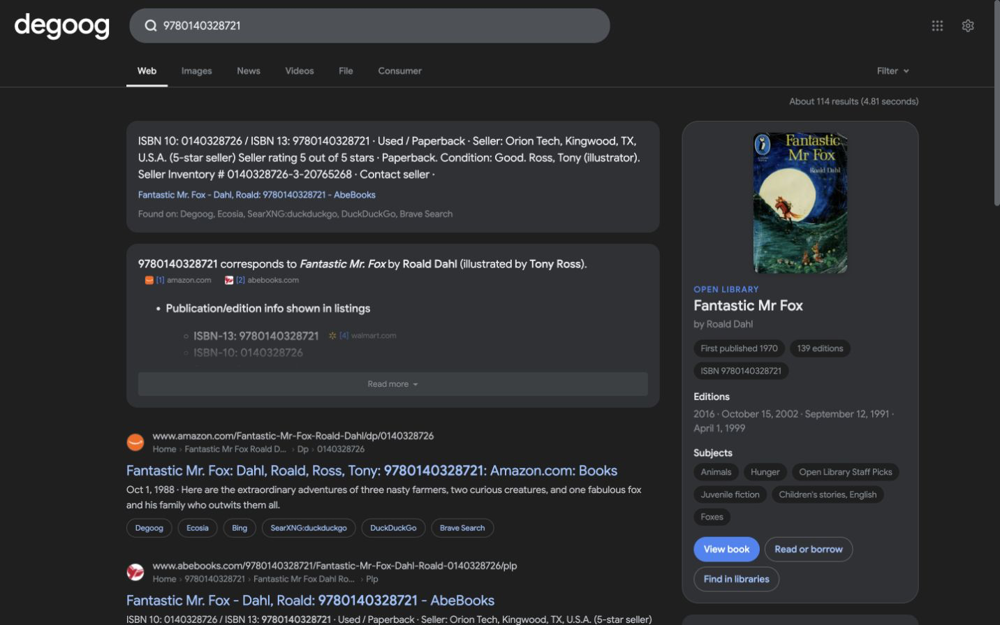

Try an ISBN such as `9780140328721`, `book dune`, or `books by ursula le guin`. The card defaults to the knowledge panel and can be moved to full width in Settings → Plugins.

A title alone, such as `the alchemist`, can now work when one of the first eight
search results is a matching Goodreads or Open Library book page. Lists, quotes,
author profiles, and conflicting matches are skipped. The card checks the title
and author against Open Library, including translated editions, before showing
metadata. Books now waits for search results; unmatched ordinary searches make
no book API request. The existing explicit title, author, and ISBN queries still work.

Book cards include ratings, page counts, a collapsible synopsis, and links to
Goodreads, StoryGraph, and libraries when metadata is available. `books by frank
herbert` shows a scrollable collection of the author's works, filtering duplicate
titles, study guides, and box sets. Reading links distinguish free public scans
from borrowing; restricted scans are not advertised as generally readable.

For **Hardcover**, add your API token in Settings → Plugins → Books / ISBN →
Configure. Get it from [Hardcover account settings](https://hardcover.app/account/api).
The token stays on the server. Hardcover adds series, moods, reader counts, and
collapsed content warnings. Missing results, invalid tokens, rate limits, and
provider failures fall back to Open Library with an explanatory note. Without a
token, Open Library continues to work. Hardcover requests are cached and guarded
at 30 per minute and 4,500 per UTC day per server process.

The only Hardcover permission needed is `read:catalog:search` (included in
`read:catalog`). Personal tokens start with `hc_pat_`; supported OAuth access
tokens and legacy JWTs also work. Malformed entries never reach Hardcover.
A 401 rejection stops further requests until you save the plugin settings again;
403 permission failures are retried after a minute so edited permissions can take
effect. Saving settings, even with the same token, also clears the old rejection.
Error notes distinguish invalid credentials, missing permissions, and other refusals.

These improvements were inspired by
[degoog-bao-home](https://codeberg.org/caiocdcs/degoog-bao-home).

</details>

<details>
<summary><strong>Search History</strong> — Local history dropdown and `!history` view</summary>

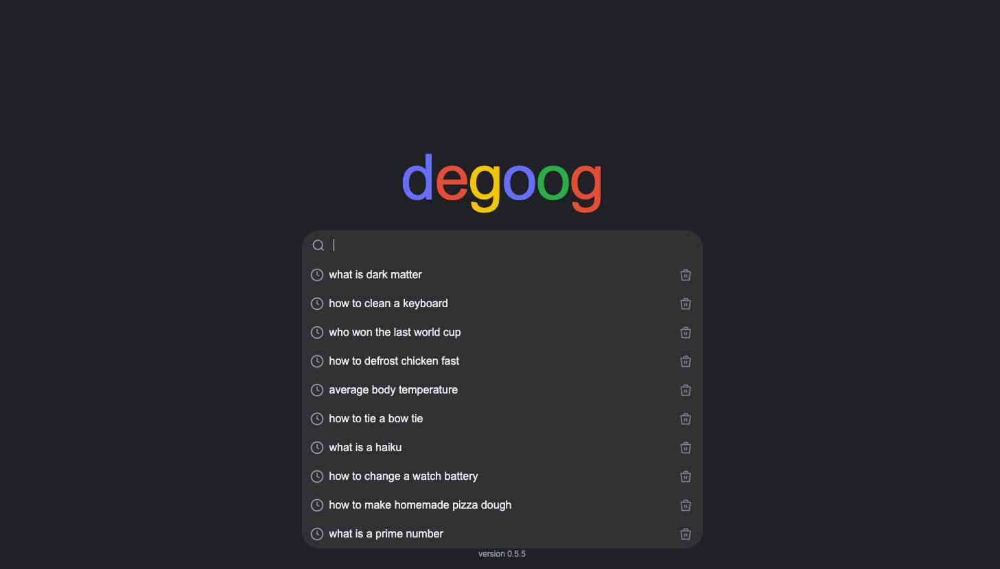

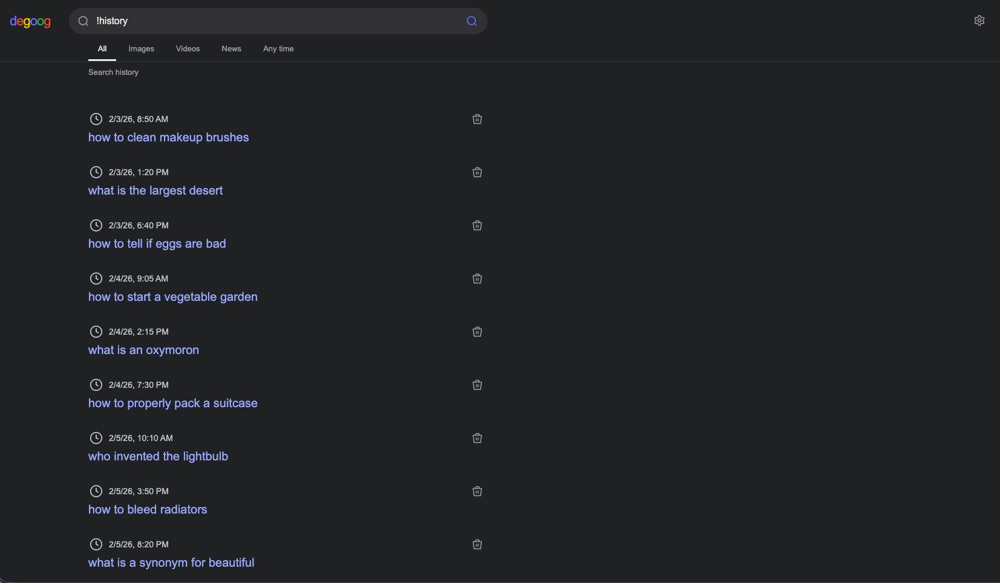

</details>

<details>
<summary><strong>Auto Bang</strong> — Keyboard-friendly bang-command autocomplete in the search suggestions panel</summary>

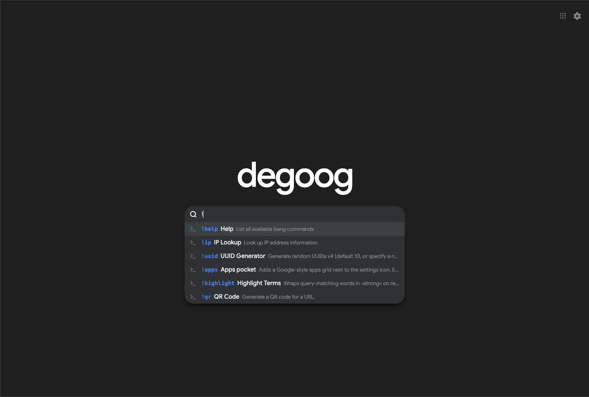

</details>

<details>
<summary><strong>Speedtest</strong> — Speed test with gauge (`!speed`, `run a speedtest`)</summary>

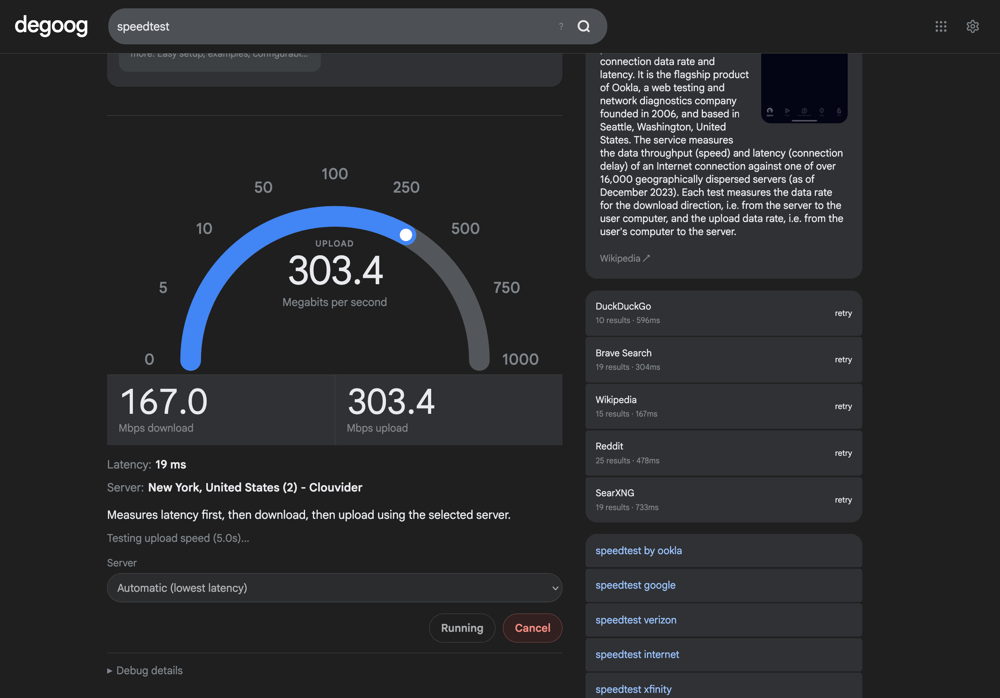

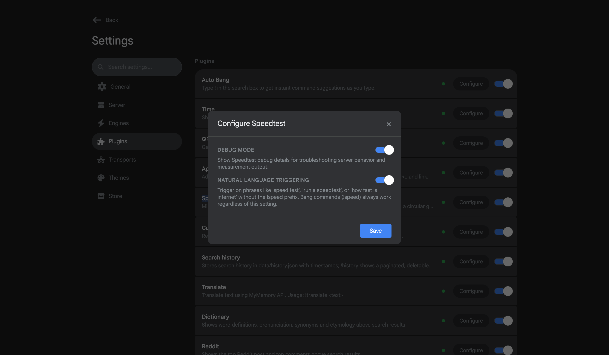

</details>

<details>
<summary><strong>Time</strong> — World clock for cities and countries (`time in France`, `!time Tokyo`)</summary>

Google-style clock card with geocoded timezone lookup and a live-updating display.

</details>

<details>
<summary><strong>Until</strong> — Countdown answers (`years until 3000`, `!until 5pm`)</summary>


Until also accepts `whens christmas`, `when is Christmas`, `how long to Easter`, `days to Arbor Day`, `time to hannukah`, or a holiday name alone (`Diwali`, `Boxing Day`, `Ganesh Chaturti`). Holiday matching is exact after spelling/punctuation normalization: `Diwali recipes` stays an ordinary search. Time and Places yield to recognized holiday names; `time in Rome` remains a clock query.

Past questions work too: `when was Ganesh Chaturthi`, `what date was Easter`, `how long ago was Christmas`, `how many days ago was Diwali`, and `when did Hanukkah start` select the most recent occurrence. Future variants include `when will Christmas be` and `when does Easter fall`. Targets can specify `last`, `previous`, `next`, or `upcoming`, and `this year`, `last year`, or `next year` (for example, `when was Christmas last year in Canada`). An explicit year keeps that year; unavailable historical dates are not guessed.

The free, offline [date-holidays](https://github.com/commenthol/date-holidays) catalog covers 206 countries and 627 national/regional calendars, with 3,400+ localized names and aliases, plus sourced Indian-festival supplements. It is bundled server-side, uses bounded caches, and adds **no holiday API requests or calendar download to the browser**. Coverage includes many Hindu, Jewish, Muslim, Christian, Buddhist, East Asian, national, and regional observances—not every festival everywhere.

Configure **Holiday calendar** with a country/region code such as `US`, `IN`, `GB`, `CA`, or `US.NE`; override it in a query such as `Thanksgiving in Canada 2026`. Cards identify the calendar used. If an unqualified festival is absent locally, Until uses a labeled fallback calendar; an explicit country never falls back to a different country. `Orthodox Easter` and `Western Easter` are separate. Dates are calendar-day countdowns, not precise local sunset calculations. Moon-sighting dates are estimates; observances and public-holiday substitutes can differ.

Holiday lookups are bounded to 1970–2080, and some source tables cover fewer years. The Indian supplements currently cover selected festivals in 2026–2027; unsupported dates get a clear unavailable message instead of fabricated annual recurrence. Ordinary absolute-date countdowns such as `years until 3000` remain supported. See [calendar sources and rebuild notes](plugins/until/vendor/date-holidays/README.md).

</details>

<details>
<summary><strong>Timer / Stopwatch</strong> — Timer and stopwatch with circular progress</summary>


</details>

<details>
<summary><strong>Tip Calculator</strong> — Interactive tip and bill split (`tip 20% on $85`)</summary>


</details>

<details>
<summary><strong>Color Translator</strong> — HEX, RGB, HSL, named CSS, UIColor, and NSColor</summary>


</details>

<details>
<summary><strong>Undecideds</strong> — Coin flip, dice, number pick, and yes/no tools</summary>

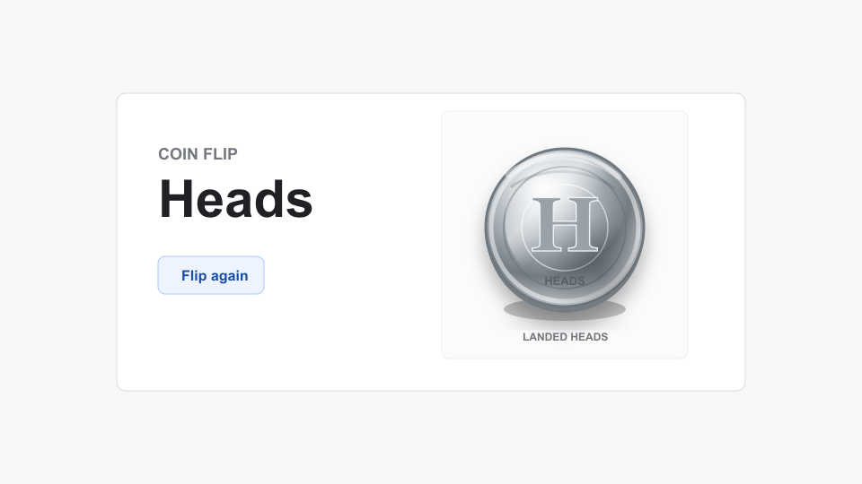

</details>

<details>
<summary><strong>Metronome</strong> — Tempo, tap tempo, and beat signatures</summary>


</details>

<details>
<summary><strong>Snake Game</strong> — Classic snake with mobile and fullscreen support</summary>


</details>

<details>
<summary><strong>Minesweeper</strong> — Play Minesweeper in search results</summary>


</details>

<details>
<summary><strong>Tic-Tac-Toe</strong> — Local multiplayer and AI difficulty</summary>


</details>

<details>
<summary><strong>Periodic Table</strong> — Interactive periodic table of elements with search, group highlighting, temperature-state simulator, and detail modals</summary>

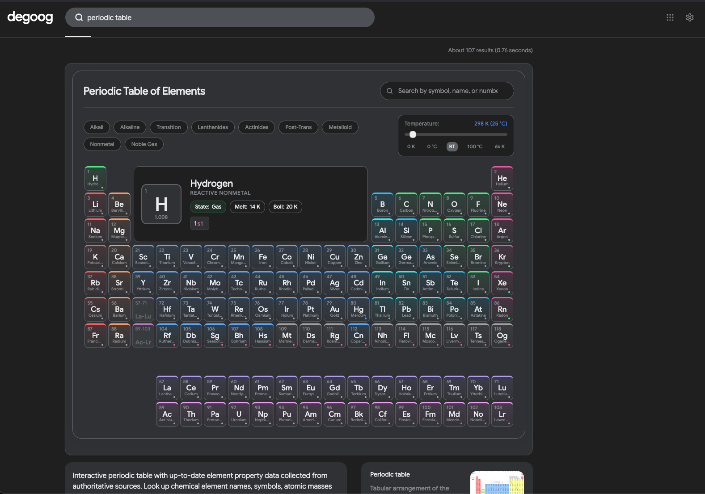

Triggers on `periodic table`, `periodic table of elements`, `!periodic`, `!elements`, and `!ptable`.

</details>

<details>
<summary><strong>Sports</strong> — Live scores, schedules, and standings from ESPN, with optional backups</summary>


Example queries: `cowboys vs eagles`, `arsenal vs chelsea`, `lakers against celtics`,
`brazil x argentina`, and `premier league standings`. ESPN works without an API
key. Optional **football-data.org** and **BALLDONTLIE** keys in Settings → Plugins
provide backups when ESPN is unavailable.

Matchups use the live game, a just-finished meeting, or the next scheduled meeting
between both teams. If the game is absent from the main scoreboard, the plugin
checks the team's schedule. Connectors include `vs`, `v`, `against`, `x`, `contra`,
and a spaced hyphen. Standings use the correct sport's logos and preserve zeroes.

Provider responses use degoog's `useCache` helper, shared across replicas when
Valkey is configured, with the legacy `createCache` fallback on older versions.
Completed game summaries and completed scoreboards for a fixed past date range
stay cached for seven days, so repeated historical lookups can reuse the same
data days later. Team catalogs also stay cached for seven days. Standings and
non-live scoreboards or schedules cache for up to 15 minutes; upcoming schedules
expire by kickoff. Live scores use 10 seconds for ESPN and football-data.org,
or 12 seconds for BALLDONTLIE. API credentials are hashed into cache keys,
failed requests are not cached, and identical concurrent requests share one
fetch within the server process. Cards render separately for each language and
selected match; live refresh uses the data's remaining cache lifetime.

</details>

### Speedtest details

**Speedtest** exposes:

- `!speedtest` as the primary trigger, with `!speed` as a fallback alias
- Natural-language phrases like `run a speedtest`, `speed test`, `speedtest`, `internet speed test`, `test my internet`, and `how fast is my internet` — Speedtest defaults its per-command **Natural language** toggle on for fresh installs. Trailing-keyword phrases like `"my internet speed test"` do **not** trigger because degoog's natural-language matcher is prefix-anchored; front-load the keyword.

> **Heads up — conflict with degoog's built-in `!speedtest`:**
> Disable degoog’s built-in `!speedtest` command when using this Store plugin. The `!speed` alias provides a fallback if the built-in is re-enabled.

### Color Translator details

**Color Translator** triggers when entering a color format:
- HEX (e.g., `#1e90ff` or `1e90ff`)
- RGB/RGBA (e.g., `rgb(30, 144, 255)`)
- HSL/HSLA (e.g., `hsl(210, 100%, 56%)`)
- CSS Named Color (e.g., `dodgerblue`, `tomato`)
- Swift/Objective-C code declarations (e.g., `[UIColor colorWithRed:0.118 green:0.565 blue:1 alpha:1]` or `[NSColor colorWithCalibratedHue:0.582 saturation:0.882 brightness:1 alpha:1]`)

It translates the color into HEX, RGB, RGB Percent, HSL, CSS Named, NSColor (calibrated/device RGB/HSB), and UIColor (RGB/HSB) with quick-copy buttons and a color swatch preview.

### Tip Calculator details

**Tip Calculator** triggers on query terms:
- `tip calculator`
- `calculate tip for 75 split by 3`
- `tip 20% on $85`
- `18% tip on 64`

It parses the bill, tip percentage, and split count directly from the query, and presents an interactive calculator with real-time bill split sliders, custom parameters, and animated value reveals.

### Undecideds details

**Undecideds** replaces the coinflip plugin with an interactive decision-making dashboard. Triggers include:
- **Coin Flip**: `coin flip`, `heads or tails`, `flip a coin` (features smooth 3D CSS coin spin animation)
- **Roll Die**: `roll a die`, `roll d20`, `roll d6` (features 3D/holographic animated rolling dice)
- **Pick Number**: `pick a number 1-100`, `random number 5 to 50` (features a staggered slot-machine digit-scrolling reveal and customizable range boundaries)
- **Yes or No**: `yes or no`, `should i` (features a rotating Yes/No wheel spinner with pointer wiggles and fun answers)

## Included Engines

This repo includes OpenAlex, Food Facts, NeoSearch, Mwmbl, icon search, and SearXNG integrations:

- **OpenAlex** — scholarly research search with `!openalex`, on the Scientific publications tab
- **Food Facts** — food product search with `!foodfacts`, using Open Food Facts' full-text API with compact product fields; includes brands, quantities, and Nutri-Scores when available
- **NeoSearch** — web results from [Neosearch](https://neosearch.org/) with `!neo`
- **Mwmbl** — independent web search with `!mw`
- **selfh.st Icons** — search the selfh.st icon collection with `!si`
- **SearXNG** — web/general results
- **SearXNG Images** — images
- **SearXNG Videos** — videos
- **SearXNG News** — news
- **SearXNG File** — files

OpenAlex searches titles, abstracts, keywords and available full text through the
[OpenAlex API](https://help.openalex.org/api/searching/). Results show authors,
publication dates, venues, citation counts, abstracts when available, and an
explicit label for retracted works. DOI queries such as `!openalex 10.1038/nature12373`
perform an exact DOI lookup. The engine replaces this collection's Papers / DOI
card; citation-copy controls are no longer included.

In **Settings → Engines → OpenAlex → Configure**, choose results per page,
relevance/newest/most-cited sorting, open-access-only results, and whether to
prefer available open-access links. Its optional API key is stored as a secret
and sent as an Authorization header. Anonymous search works within OpenAlex's
keyless allowance; a verified key increases that allowance. HTTP and usage-limit
failures are reported instead of being shown as ordinary empty searches.

Use degoog's normal **Timeout (ms)** setting. OpenAlex adds no internal deadline,
request-timeout parameter, retries, or private result cache. Basic pagination
covers the first 10,000 matches; date filters use UTC publication dates, with
the hour filter covering today because OpenAlex records publication dates
without a time of day. Language selection does not restrict the research corpus.

Removing an item from the Store listing does not uninstall old copies. Existing
users should uninstall **Papers / DOI** in Settings → Plugins if it is still
installed; updating this repository alone does not remove it from their server.

Mwmbl uses degoog's **Settings → Engines → Mwmbl → Configure → Timeout (ms)**.
Leave it blank to use degoog's default. The engine has no hardcoded timeout or
automatic retry.
Use a direct transport to avoid spending the deadline on browser startup.

Mwmbl's **Search mode** can use its native index through the provider's live
results page (`native`), or the full JSON search API (`api`, the default).
Native mode omits the API's optional live Wikipedia enrichment, which can stall
an otherwise fast index lookup. It can therefore return fewer results on some
queries. Both modes report provider and parsing failures and use the same
configured engine deadline.

SearXNG Videos includes optional [server-side Vimeo, YouTube, and Brave adapters](engines/searxng-videos/searxng/INSTALL.txt).
Vimeo and YouTube request compact responses while retaining the upstream
parsers and pagination. Brave supports the provider's function-wrapped result
data and reuses SearXNG's video mapping without executing provider JavaScript.
Install them on your SearXNG host; adding the Store engine alone does not
activate them. The official SearXNG files remain unchanged.

The Images and Videos connectors validate the result payload and report empty responses
with provider failures as errors. They keep valid partial results and record
failed providers in the server log without logging the search query. Degoog's
current successful-result contract has no field for those provider warnings in
its performance row.

Images uses degoog's **Timeout (ms)** setting and normal request cancellation.
The connector adds no separate deadline or per-query collection limit. SearXNG's
own provider timeouts remain controlled by its server settings.

NeoSearch needs no API key. With **Fetch**, it flattens Neosearch's grouped results
into one deduplicated list and stops reading once those results arrive. With
**4play**, Auto mode reads the rendered results page instead, letting Firefox
handle the website's required search token. Browser mode returns the active lens
and uses Neosearch's region setting in that browser; the engine's **Search region**
setting applies only to API mode. Fetch is faster, while browser mode includes
page loading. Both support one page; date and safe-search filters are not
available. Use degoog's **Timeout (ms)** for the deadline. There is no built-in
timeout or automatic retry in the engine.
The public service currently advertises a **100-search daily limit**, so bang-only
use is a good starting point. Uncached searches can be slower because Neosearch
processes results with AI. This connector uses the website's search interface,
which can change; it is not an independent index or a guaranteed public API.

Qwant and Yahoo are no longer listed in this Store. Our live tests found
unreadable responses or verification challenges with Qwant, challenges and
timeouts with Yahoo. Their source and tests remain in the repository for future
work; existing installations are not automatically removed.

The SearXNG engines connect to your instance via its JSON API.

**SearXNG settings (via Configure button):**
- **SearXNG URL** — Base URL of your instance (default: `http://127.0.0.1:8888`)
- **Categories** — Override the default category for that engine (for example `general`, `images`, `videos`, `news`, or `files`)
- **Engines** — Use specific SearXNG engines only (for example `google`, `bing`, `duckduckgo`, `wikipedia`)
- **Safe Search** — 0 (off), 1 (moderate), 2 (strict)

## Installation

1. Open degoog **Settings > Store**
2. Add this repository URL:
   ```
   https://github.com/SoPat712/degoog-toolkit.git
   ```
3. Install the engines you want
4. Install the plugins or themes you want from this repository
5. Go to **Settings > Engines**, click **Configure** on each installed SearXNG engine, and set your instance URL
6. Go to **Settings > Plugins**, click **Configure** on any installed plugin that needs setup, and add its keys or preferences

## Prerequisites

For the SearXNG engines, run a SearXNG instance with JSON output enabled:

```bash
docker run -d --name searxng -p 8888:8080 \
  -e SEARXNG_SECRET=your-secret \
  searxng/searxng:latest
```

Make sure `json` is listed in `formats` in your SearXNG `settings.yml`:

```yaml
search:
  formats:
    - html
    - json
```

The Sports plugin uses ESPN without a key. Optional backup providers need user-supplied keys:

- [football-data.org](https://www.football-data.org/client/register)
- [BALLDONTLIE](https://app.balldontlie.io)

TMDB also requires a user-supplied API key from [The Movie Database](https://www.themoviedb.org/settings/api).

## Development verification

Run the repository-owned suite with:

```bash
npm ci --ignore-scripts
npm test
```

Cheerio is a development dependency for the engine tests. Installed engines
use the copy provided by degoog.

This syntax-checks JavaScript and runs tests only from `engines/`, `plugins/`, and `themes/`; it never enters the reference `examples/` or upstream `source/` trees. To run the same explicitly discovered test set under Bun:

```bash
npm run test:bun
```

## Plugin languages

Plugins target English, German, Spanish, French, Italian, Portuguese, Russian, Ukrainian, and Chinese. See [the translation guide](docs/plugin-translations.md) for catalog conventions, fallback behavior, and validation.
